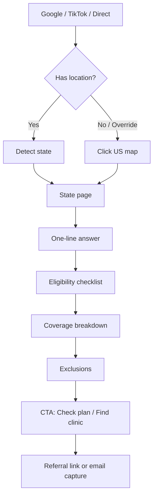
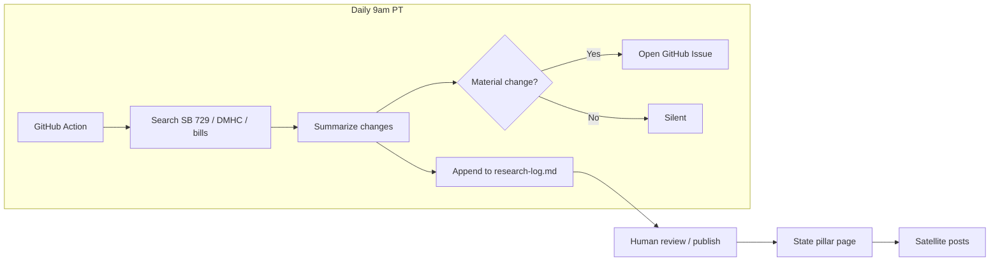

# Fertility Coverage Map
## Technical Requirements Document & Automated Business Plan

**Version:** 1.0  
**Date:** 2026-10-20  
**Owner:** Rez  
**Repo:** [creativerezz/fertility-coverage-map](https://github.com/creativerezz/fertility-coverage-map)

---

## 1. Product Summary

Interactive US map that answers one question in under 5 seconds:

> “Does my state’s insurance cover egg freezing?”

User lands → geolocates or taps a state → sees clear eligibility, coverage limits, and exclusions. California (SB 729) is the flagship page.

**Monetization (v1):** Clinic referral fees ($50–$150 per booked consult).  
**v2:** Neutral patient-owned storage tracker app.

---

## 2. Market Snapshot

| Metric | Value | Source / Notes |
|--------|-------|----------------|
| Elective egg-freezing cycles / year (US) | ~16,400 | SART / UCLA study (2021 data, still best public number) |
| Global egg-freezing services market | ~$6B | North America ~$2.6B |
| YoY growth in cycles | +39% | Largest single-year jump recorded |
| Core Google searches / month (US) | ~30,000 | “egg freezing” + cost + preservation + near me |
| Search growth since 2023 | +67% | Fastest-growing fertility cluster |
| Long-tail question queries | 62% | Exact lane for coverage explainers |
| TikTok #eggfreezing lifetime views | 95M+ | Ads banned — organic only |
| Average storage fee revenue per clinic | $1M+/year | Single large clinic example |

---

## 3. User Flow



---

## 4. Technical Stack

| Layer | Choice | Why |
|-------|--------|-----|
| Framework | Next.js 15 + TypeScript | App router, SEO, speed |
| UI | Tailwind + shadcn/ui | Fast, clean, accessible |
| Map | react-simple-maps | Lightweight SVG, no heavy map tiles |
| Database | Supabase | Auth, realtime, simple Postgres |
| Hosting | Vercel | Zero-config, edge |
| Analytics | Plausible | No cookie banner, privacy-friendly |
| Automation | GitHub Actions | Daily research cron |

---

## 5. Content Engine Architecture



**Pillar page template (1,200–1,800 words):**
1. One-line answer
2. Eligibility checklist (plan type, employer size, renewal date)
3. What’s covered (retrievals, transfers, storage years)
4. What’s excluded (elective, self-funded, Medi-Cal, marketplace)
5. CTA

---

## 6. 30-Day Launch Plan

| Week | Focus | Deliverables |
|------|-------|--------------|
| 1 | California + Map MVP | CA pillar, map with 5 clickable states, daily cron live |
| 2 | High-volume states | TX, NY, FL pillars + 3 satellites each, email capture |
| 3 | Scale + TikTok | Top-10 states, 10-post backlog, 2 creator outreaches |
| 4 | Trust & distribution | Lawyer review ($1–2k), Search Console, 20 HARO, data post |

**Target by day 30:** 5,000 sessions, 50 email captures.

---

## 7. TikTok / Organic Strategy

- 3–5 posts/week, 30–60s
- Hook in first 2 seconds
- Formats: map POV, myth-bust, plain-English SB 729
- Partner micro-creators (10k–100k) — educational, not hard sell
- TikTok bans paid fertility ads → organic is the only scalable channel

---

## 8. Data Model (JSON)

```json
{
  "state": "CA",
  "mandate": true,
  "ivf_coverage": "large fully-insured plans",
  "egg_freezing": "up to 3 retrievals + 5yr storage",
  "elective_covered": false,
  "notes": "SB 729 effective 2026-01-01. Self-funded exempt."
}
```

Adding a new state = edit one JSON entry + generate pillar from template.

---

## 9. Risks & Moat

| Risk | Mitigation |
|------|------------|
| Laws change fast (DMHC revised Oct 5) | Daily automation + changelog |
| Self-funded plans exempt | Clear eligibility checker |
| SEO takes 3–6 months | Ship California week 1, velocity matters |
| Clinic-owned tools exist | Neutral third-party positioning |

**Moat:** Daily regulatory pulse + neutral map that works for every clinic, not just one provider’s patients.

---

## 10. Open Questions

- Exact referral terms with 3 pilot clinics
- Charge clinics for map placement? (yes/no)
- Include sperm freezing on state pages? (low effort, expands TAM)
- Domain name finalization

---

*Generated from conversation 2026-10-20. Update via daily research log.*
